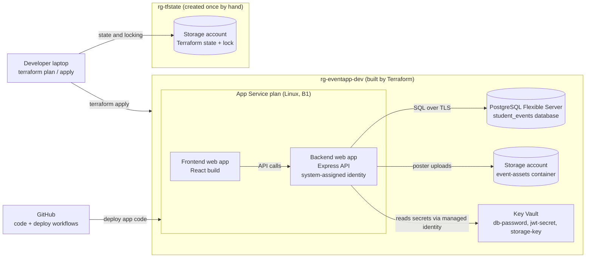

# Azure infrastructure as code (Terraform)

This folder rebuilds the Azure hosting for the Cloud Student Event Management app as code. The original team project was set up by hand in the Azure portal; here every resource is defined in Terraform, so the whole environment can be reviewed, recreated and destroyed with a single command.

## Architecture



## What Terraform builds

| Resource | Purpose |
| --- | --- |
| Resource group | Holds everything for one environment |
| App Service plan (Linux, B1) | Compute shared by both web apps |
| Frontend web app (module) | Serves the React site |
| Backend web app (module) | Runs the Express API, with a system-assigned managed identity |
| PostgreSQL Flexible Server + database | Stores users, events and registrations |
| Firewall rules | Allow Azure services and the developer's IP |
| Storage account + `event-assets` container | Holds uploaded event posters |
| Key Vault + 3 secrets | Stores the database password, JWT secret and storage key |
| Role assignments | Terraform can write secrets; the backend can only read them |

Secrets are generated by Terraform (`random_password`), so nobody types or sees them. The backend's App Settings reference Key Vault (`@Microsoft.KeyVault(SecretUri=...)`) instead of holding the values, and App Service resolves them at runtime using the backend's managed identity.

## Terraform concepts used

- **Providers and version pinning:** `azurerm` 4.x and `random`, locked in `.terraform.lock.hcl`.
- **Variables, locals and tfvars:** one configuration builds `dev` or `prod` from `dev.tfvars` or `prod.tfvars`.
- **Resource references and dependencies:** values such as the database hostname flow into the backend's settings automatically; `depends_on` is used where Terraform can't infer an order (secrets need the Key Vault role first).
- **Reusable module:** `modules/web-app` defines a Linux web app once and is called for both the frontend and backend.
- **Safe refactoring with `moved` blocks:** the web apps were moved into the module without being destroyed and recreated.
- **Remote state:** stored in Azure Blob Storage with state locking, authenticated through Azure AD and RBAC rather than storage keys.
- **Data sources, sensitive outputs and lifecycle rules.**

## Folder layout

```
infra/
├── backend.tf          Remote state configuration
├── providers.tf        Required providers and versions
├── variables.tf        Inputs: project, environment, location, my_ip
├── dev.tfvars          Values for the dev environment
├── prod.tfvars         Values for the prod environment
├── main.tf             All resources
├── outputs.tf          App names, URLs and database host
└── modules/
    └── web-app/        Reusable Linux web app module
```

## Running it

**Prerequisites:** Terraform 1.6 or later, the Azure CLI, and an Azure subscription.

1. **Log in and select the subscription:**

   ```bash
   az login
   export ARM_SUBSCRIPTION_ID=$(az account show --query id -o tsv)
   ```

2. **Create the state storage once** (a resource group, storage account and `tfstate` container), give your account the *Storage Blob Data Contributor* role on it, and update `backend.tf` with the storage account name.

3. **Set your IP** in `dev.tfvars` (`curl -s https://ifconfig.me`), so you can reach the database.

4. **Build the environment:**

   ```bash
   cd infra
   terraform init
   terraform plan -var-file=dev.tfvars
   terraform apply -var-file=dev.tfvars
   ```

5. **Load the database schema:**

   ```bash
   export PGPASSWORD=$(terraform output -raw db_admin_password)
   psql "host=$(terraform output -raw db_host) user=eventadmin dbname=student_events sslmode=require" \
     -f ../backend/schema.sql
   ```

6. **Deploy the app** with the GitHub Actions workflows in `.github/workflows`, using the app names from `terraform output`.

7. **Tear it down** when finished:

   ```bash
   terraform destroy -var-file=dev.tfvars
   ```

### Switching environments

Each environment has its own state file:

```bash
terraform init -reconfigure -backend-config="key=eventapp-prod.tfstate"
terraform plan -var-file=prod.tfvars
```

Always check that the resource names in the plan match the environment you intend to change.

## Next steps

- Run Terraform from a GitHub Actions or Azure DevOps pipeline using OIDC (passwordless) login, with plan on pull requests and apply after approval.
- Place the app in a hub-and-spoke virtual network with private endpoints for the database and Key Vault.
- Containerise the app and run it on Azure Kubernetes Service with Azure Container Registry.
